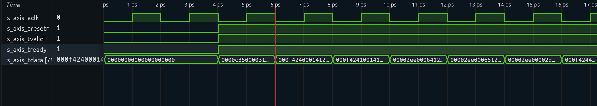
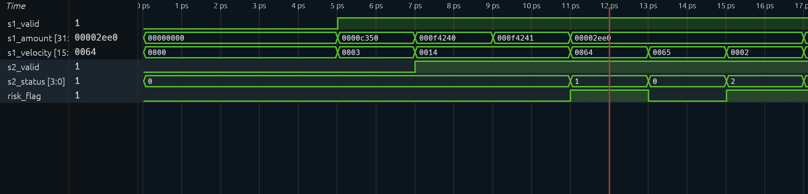
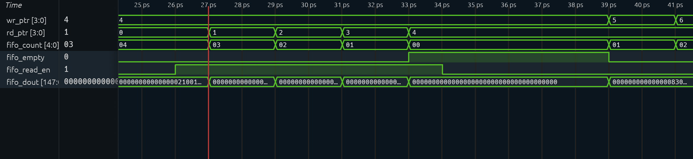

# FPGA Pretrade Risk Engine

**FPGA Pretrade Risk Engine — Low-Latency Dual-Plane Crypto Risk Gateway** is a portfolio engineering prototype that pairs a deterministic RTL pre-trade fast path with a Python scoring, replay, and investigation slow path. It demonstrates how a compact hardware policy engine can raise immediate reason-coded alerts while a service tier adds richer model and analyst context.

> **Project scope:** This Engine is not a production trading system. The RTL is verified in Verilator and synthesized with generic Yosys flows, but is not deployed to an FPGA or connected to a hardware transport. The investigation providers are deterministic mocks, not a live LLM or external blockchain/compliance service. The graph dashboard includes a bundled demo fixture. Measure and validate all behavior on the intended deployment target before relying on it operationally.

## Dual-plane architecture

```text
                        ┌──────────────────────────┐
 Transaction stream ──▶│ Fast path: SystemVerilog │
                        │ AXI-Stream, 2-stage checks│
                        └────────────┬─────────────┘
                                     │ reason-coded risk alert
                                     ▼
                        ┌──────────────────────────┐
                        │ Synchronous alert FIFO  │
                        └────────────┬─────────────┘
                                     │ host drain / simulation JSONL
                                     ▼
                        ┌──────────────────────────┐
                        │ Python async bridge     │──▶ FastAPI /hardware-alerts
                        └──────────────────────────┘                 │
                                                                      ▼
 ┌────────────────────┐    ┌────────────────────┐    ┌─────────────────────┐
 │ bounded async replay│──▶│ FastAPI /score      │──▶│ temporal XGBoost     │
 └────────────────────┘    └────────────────────┘    └─────────────────────┘
                                                                      │
                                                       investigator mock tools
                                                                      │
                                                        JSONL reports / dashboard
```

### Fast path: hardware policy

The SystemVerilog accelerator accepts an 80-bit AXI-Stream packet `{amount[31:0], velocity[15:0], wallet_id[31:0]}`. Parallel amount, velocity, and watched-ID checks feed a two-stage pipeline with a fixed decision latency and one-packet-per-cycle throughput while capacity is available. Risky transactions are automatically queued in a parameterized synchronous FIFO with the original packet fields, reason bitmap, and ingress timestamp. FIFO slot reservation backpressures the AXI source before alerts can be lost.

The Verilator C++ harness checks decisions, alert contents, timestamp alignment, FIFO fill/drain, and backpressure, and emits `hardware/alerts.jsonl`. The Makefile also provides lint and generic Yosys synthesis targets. GitHub Actions is configured to run lint, simulation, synthesis, and archive outputs on hardware workflow changes. A configured workflow is not a claim that a particular remote CI run is currently green.

### Slow path: scoring and investigation

FastAPI serves `/score`, `/schema`, `/dashboard`, and `/hardware-alerts`. The model pipeline is an XGBoost ensemble trained on time-ordered partitions: early timesteps train, middle timesteps select the validation operating threshold, and later timesteps provide held-out reporting. The bounded asyncio worker can replay held-out transactions through the scorer and report throughput plus p50/p99 request latency.

The hardware bridge asynchronously reads the Verilator JSONL export (or a raw packed FIFO word) and posts decoded policy alerts to `/hardware-alerts`. That endpoint records the RTL reason bits and attaches deterministic mock wallet-history and fund-flow context. It does not pass the 80-bit hardware packet to `/score`: that endpoint requires the complete model feature schema. Standard model investigations are also deterministic mock tools today; a live LLM and external evidence providers are not implemented.

## Engineering highlights

- Two-stage, cycle-aligned AXI-Stream risk datapath with explicit packet and FIFO layouts.
- FIFO capacity reservation and source backpressure to avoid dropping high-risk alerts.
- Directed Verilator tests for policy boundaries, FIFO payloads, timestamp capture, full conditions, draining, and resumed traffic.
- Generic Yosys synthesis/report target and a GitHub Actions hardware workflow.
- Leakage-aware temporal model splits and validation-only threshold selection.
- Async replay with bounded concurrency and service latency/throughput reporting.
- Idempotent hardware-alert ingestion with structured investigation persistence.

## Repository layout

```text
hardware/
  rtl/risk_accelerator.sv       AXI-Stream risk pipeline and slow-path alert FIFO
  tb/tb_risk_accelerator.cpp    Verilator driver and JSONL alert exporter
  Makefile                      run, lint, synth, and clean targets
service/
  app/main.py                   FPGA Pretrade Risk Engine FastAPI scoring and alert endpoints
  app/schemas.py                API request/response contracts
  hardware_bridge.py            async FIFO export to service relay
streaming/                      bounded async scoring/replay worker
model/                           temporal XGBoost training and artifact loading
agent/                           deterministic mock investigation workflows
src/                             Next.js monitoring dashboard
tests/                           Python service/model/artifact tests
.github/workflows/
  hardware_ci.yml                Verilator and Yosys CI workflow
fraud-detection-dataset/          local-only raw Elliptic CSVs (gitignored)
artifacts/                        local model, metrics, and investigation output
```

## Reproduce the project

### 1. Download the dataset

The raw Elliptic dataset is **excluded from Git** because of its size and separate license terms. Download the original data from [the Elliptic dataset page on Kaggle](https://www.kaggle.com/ellipticco/elliptic-data-set). Kaggle currently lists the dataset under **CC BY-NC-ND 4.0**; review the current terms and attribution requirements before use. This project does not redistribute the data. The dataset describes three CSV files; extract them into `fraud-detection-dataset/`:

```text
fraud-detection-dataset/
├── elliptic_txs_features.csv
├── elliptic_txs_classes.csv
└── elliptic_txs_edgelist.csv
```

The training/replay code reads the feature and class files; the edge list is retained for dataset completeness. The directory is gitignored.

### 2. Train the temporal XGBoost model

From the repository root:

```bash
python -m pip install -r model/requirements.txt -r service/requirements.txt
python model/train.py \
  --data-dir fraud-detection-dataset \
  --artifact artifacts/fraud_ensemble.json \
  --review-capacity 0.01
```

Training writes the native model bundle and metrics under `artifacts/`. The threshold is selected on validation scores; the later test partition uses that frozen threshold. The ensemble spread is not a calibrated confidence interval.

### 3. Run the API and web dashboard with Docker Compose

With the model artifact available:

```bash
docker compose up --build scoring web
```

Open the dashboard at `http://localhost:3000` and the API docs at `http://localhost:8000/docs`. The scoring service needs the generated artifact. To run the held-out replay, open another terminal:

```bash
docker compose --profile replay run --rm replay-worker
```

For local development, install `streaming/requirements.txt` and run `uvicorn service.app.main:app --host 0.0.0.0 --port 8000`. Then run the worker with `python -m streaming.worker --mode replay --split test --count 100 --workers 8 --rate 20`.

### 4. Simulate, synthesize, and relay the hardware alerts

Requirements: Verilator with VCD tracing, Yosys, GNU Make, and a C++17 compiler. From the repository root:

```bash
make -C hardware lint
make -C hardware run
make -C hardware synth
```

`make run` creates `hardware/risk_accelerator.vcd` and `hardware/alerts.jsonl`. The generic Yosys cell/resource report is written to `hardware/build/synth_report.txt`; this is not a vendor FPGA place-and-route or timing result. View the waveform with `surfer hardware/risk_accelerator.vcd`.

With the FastAPI service running, relay the simulated FIFO alerts and attach the deterministic investigation context:

```bash
python -m service.hardware_bridge \
  --input hardware/alerts.jsonl \
  --api-url http://127.0.0.1:8000
```

Use `--dry-run` to decode and print events without calling the API. The bridge also accepts JSONL records with a raw `fifo_dout` hexadecimal/integer value using the default 148-bit FIFO layout. This bridge is a simulation/software integration path; it is not a physical FPGA driver.

### 5. Run the Python suite

```bash
python -m unittest discover -s tests
```

The hardware simulation and synthesis are run separately by the commands above and by the configured hardware GitHub Actions workflow.

## Performance, Synthesis & Verification Results

The hardware accelerator (`fpga-pretrade-risk-engine`) is verified using cycle-accurate Verilator simulation waveforms and synthesized via Yosys to evaluate hardware complexity and deterministic execution latency.

### 1. Hardware Latency & Pipeline Performance
* **Execution Latency:** **2 clock cycles** fixed pipeline latency from AXI-Stream input (`s_axis_tdata`) to threshold evaluation (`s2_status`) and alert assertion (`risk_flag`).
* **Throughput:** Supports continuous back-to-back single-cycle packet streaming over the AMBA AXI-Stream interface without handshake bubbles.

### 2. Yosys Post-Synthesis Resource Utilization
Synthesized via Yosys targeting standard cell logic mapping:

| Resource Metric | Count / Bits | Description |
| :--- | :--- | :--- |
| **Total Cells** | **5,465** | Total mapped logic and sequential cells |
| **Flip-Flops (DFFs)** | **2,352** (`$_DFFE_PP_`) | Pipeline registers, state machines, and FIFO storage elements |
| **Multiplexers** | **2,209** (`$_MUX_`) | Datapath routing and threshold routing logic |
| **Logic Gates** | **~904** | Combined AND, OR, NOT, XOR, and XNOR gates (`$_AND_`, `$_OR_`, etc.) |
| **Total Wires / Bits** | **2,556 / 5,634** | Internal structural netlist connectivity |

---

### 3. Simulation Waveform Verification (Surfer Traces)

The simulation waveforms below illustrate cycle-accurate execution across the AXI-Stream interface, the 2-stage pipeline evaluation, and the slow-path alert FIFO queue management:

#### A. AXI-Stream Ingestion & Handshake
*Shows active clock (`s_axis_aclk`), reset release (`s_axis_aresetn`), ready/valid handshakes, and incoming 80-bit packet streams (`s_axis_tdata`).*


#### B. 2-Cycle Fixed Pipeline Evaluation
*Demonstrates stage 1 decoding (`s1_valid`, `s1_amount`), stage 2 status flags (`s2_status`), and real-time risk assertion (`risk_flag`).*


#### C. Slow-Path Alert FIFO Draining
*Captures circular buffer pointers (`wr_ptr`, `rd_ptr`), FIFO occupancy (`fifo_count`), read enables (`fifo_read_en`), and payload extraction (`fifo_dout`) for software bridge consumption.*


## Dataset and evaluation notes

The raw dataset is provided by Elliptic and available through Kaggle under the license shown on the dataset page. Cite Elliptic and the associated research publication when using the data. The model's temporal test metrics are offline historical results and do not establish future detection performance. Threshold ties can push the realized validation alert fraction above the requested review budget.

## Known limits

- RTL wallet detection is an exact illustrative 32-bit ID match, not a maintained sanctions/watchlist lookup or cryptographic address hash.
- The current FIFO shares the AXI clock; crossing into another clock domain requires an asynchronous FIFO or another CDC-safe interface.
- Hardware transfers from a physical FPGA are not implemented. The bridge currently consumes a simulator JSONL export or packed payload records.
- The hardware alert endpoint preserves RTL policy reasons; it does not create a model score from the reduced hardware packet.
- Wallet/fund-flow tools are deterministic mocks. No LLM provider, blockchain API, or compliance decision system is connected.
- The graph page uses a bundled labeled demo fixture, not a live network feed.
- Service metrics and investigations use local files; multi-instance deployment needs shared durable storage and a broker.
- Report target-specific p50/p95/p99 latency and synthesis/timing results before making service-level or hardware performance claims.
